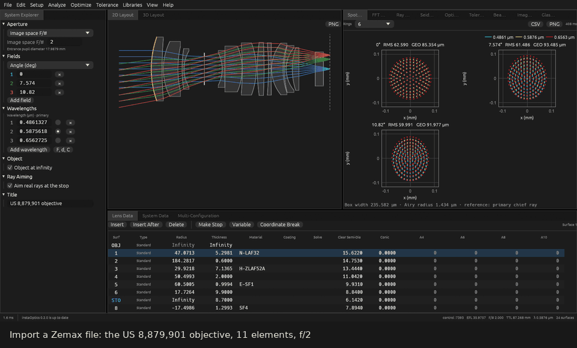

<p align="center">
  
</p>

<h1 align="center">instaOptics</h1>

<p align="center">
  <strong>Free and open-source optical simulation software, written in pure Rust.</strong><br />
  Sequential lens design and analysis: edit the lens and every analysis follows. Run it on the desktop, script it from the command line, or let AI agents work on the lens through the built-in MCP server.
</p>

<div align="center">

[][releases]
[][releases]
[][releases]
[](https://instaoptics.oneptica.com)

</div>

<p align="center">
  <a href="https://github.com/Oneptica/instaOptics/actions/workflows/ci.yml"></a>
  <a href="https://github.com/Oneptica/instaOptics/releases/latest"></a>
  <a href="https://github.com/Oneptica/instaOptics/releases"></a>
  <a href="LICENSE"></a>
</p>

<p align="center">
  <a href="README.zh-CN.md">中文</a> ·
  <a href="#download">Download</a> ·
  <a href="#features">Features</a> ·
  <a href="#accuracy">Accuracy</a> ·
  <a href="#build-from-source">Build</a> ·
  <a href="#ai-agents-mcp">MCP</a> ·
  <a href="#cli--scripting">CLI</a> ·
  <a href="#documentation">Docs</a>
</p>



*The US 8,879,901 objective (11 elements, f/2) imported from a Zemax file: the image plane moves and the spot diagrams follow, the back focus is optimized, then the MTF and the 3D layout. Recorded with the [demo script](examples/demo/record.py), which drives the app through the same commands the menus run.*

## Download

| Platform | Package | Notes |
|---|---|---|
| **Windows** | `.msi` installer | Auto-updates on next start |
| **macOS** | `.dmg` disk image | Universal (Apple silicon & Intel) |
| **Linux** | `AppImage`, `.deb`, `.tar.gz` | AppImage auto-updates on next start |
| **Web** | [instaoptics.oneptica.com](https://instaoptics.oneptica.com) | Runs in the browser without installation |

Installers are available on the [releases page][releases]. Installed desktop builds check for updates at start-up. Versions up to `0.1.8` were Electron-based—download `0.2.0` once manually to switch to the native Rust build.

## Features

### Sequential Ray Tracing & System Modeling
- **Surfaces:** spherical, conic, and even-asphere surfaces, mirrors, and coordinate breaks with real ray aiming
- **Aperture & Fields:** entrance pupil diameter, F/#, object NA, float by stop; angle, object height, and image height fields
- **Glass Catalogs:** built-in Schott catalog, fused silica, CaF₂, and `nd/vd` model glasses; load OpticStudio `.agf` catalogs (all 13 dispersion formulas) with an interactive search window and Abbe diagram
- **Multi-Configuration & Solves:** multi-configuration systems, marginal ray height solves, and parameter pickups

### Analyses & Visualization
- **Geometric & Diffraction:** spot diagram, ray fan, FFT MTF, through-focus MTF, MTF vs. field, FFT PSF, wavefront map
- **Aberrations & Illumination:** field curvature and distortion, chromatic focal shift, Seidel aberrations, relative illumination, footprint diagram
- **Layouts & Export:** interactive 2D and 3D layouts; export any plot as PNG and underlying data as CSV

### Physical Optics, Coatings & Polarization
- **Beam Propagation:** Gaussian, super-Gaussian, and flat-top beams propagated on axis or along a field's chief ray, with side view, cross sections, beam radius, and single-mode fiber coupling
- **Coatings & Polarization:** per-surface thin-film coatings (MgF₂, quarter-wave layers, high reflectors, metals), reflectance/transmittance curves, and polarization ray tracing (transmission, diattenuation, and retardance across the pupil)
- **Image Simulation:** simulate imaging through the system using built-in test charts or arbitrary images

### Optimization & Tolerancing
- **Damped Least Squares Optimization:** merit function editor with operands for EFL, track length, distortion, chief ray angle, and more, configurable per field and configuration
- **Tolerancing:** sensitivity analysis and Monte Carlo simulation

### Interoperability & Interface
- **Zemax Compatibility:** import and export `.zmx` files
- **Multilingual UI:** English, 简体中文, 繁體中文, 日本語, 한국어, Deutsch, Français, Español, and Русский (*View → Language*)

## Accuracy

The US 8,879,901 objective is cross-checked against [optiland](https://github.com/HarrisonKramer/optiland), an independent open-source ray tracer, as part of `cargo test`:
- **Paraxial quantities** (EFL, BFL, pupil diameter, and pupil positions) agree within `1.2e-5` relative error.
- **Real ray tracing** across 54 rays (3 fields × 3 wavelengths × 6 pupil points) lands within `0.02 µm` of optiland at the image plane.

Reference validation script: [examples/validation/us8879901.py](examples/validation/us8879901.py).

## Build from Source

Requires **Rust 1.95+** (stable). Linux builds require no extra system packages (file dialogs use the XDG desktop portal).

```sh
cargo run --release -p instaoptics                   # launch the desktop app
cargo run --release -p instaoptics-cli -- commands   # list every command and its parameters
cargo test --workspace                               # run the full test suite
```

Platform packaging scripts live in [packaging/](packaging/). See [docs/architecture.md](docs/architecture.md) for the crate layout.

## AI Agents (MCP)

`instaoptics-cli mcp` exposes a [Model Context Protocol](https://modelcontextprotocol.io) server over stdio. It can run standalone on its own lens or attach to a live desktop window so you can watch edits in real time.

- **Standalone (headless):**
  ```sh
  claude mcp add instaoptics -- instaoptics-cli mcp
  ```
- **Connected to the desktop app:**
  ```sh
  instaoptics --control 7391
  instaoptics-cli mcp --connect 127.0.0.1:7391
  ```

Standard MCP client configuration (e.g. Claude Desktop, Cursor):

```json
{
  "mcpServers": {
    "instaoptics": {
      "command": "instaoptics-cli",
      "args": ["mcp", "--connect", "127.0.0.1:7391"]
    }
  }
}
```

Available tools (`inspect`, `execute`, `analyze`, `render`, `list_commands`, `screenshot`, `open_window`) and a sample session are documented in [docs/mcp.md](docs/mcp.md).

## CLI & Scripting

Every menu action maps to a command, and `instaoptics-cli` runs on the same command registry:

```sh
instaoptics-cli convert design.zmx design.iol
instaoptics-cli analyze lens.iol --request '{"kind":"mtf"}'
instaoptics-cli render lens.iol --view spot --out spot.png
instaoptics-cli run lens.iol \
  --cmd 'variable {"surface":2,"parameter":"radius"}' \
  --cmd 'optimize {"cycles":20}' \
  --save out.iol
```

Lens files use the `.iol` (JSON) format. Units are **mm** for lengths, **µm** for wavelengths, and **degrees** for angles. Surfaces are 1-indexed in commands and the UI.

## Documentation

| Document | Contents |
|---|---|
| [docs/architecture.md](docs/architecture.md) | Crate layering (`core` → `io`/`render` → `engine` → `ui-egui`/`mcp`), figure pipeline, background workers |
| [docs/cli.md](docs/cli.md) | CLI subcommands, script files, environment variables, exit codes |
| [docs/mcp.md](docs/mcp.md) | MCP server setup, tool reference, example agent workflow |
| [docs/control-protocol.md](docs/control-protocol.md) | TCP control channel protocol for driving the live desktop app |

## License

Licensed under the [MIT License](LICENSE).

[releases]: https://github.com/Oneptica/instaOptics/releases/latest
