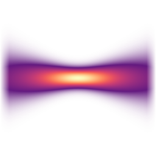

<p align="center">
  
</p>

<h1 align="center">instaOptics</h1>

<p align="center">
  <strong>Free and open-source optical simulation software, written in pure Rust.</strong><br />
  Sequential lens design and analysis: edit the lens and every analysis follows. Run it on the desktop, script it from the command line, or let AI agents work on the lens through the built-in MCP server.
</p>

<div align="center">

[][releases]
[][releases]
[][releases]
[](https://instaoptics.oneptica.com)

</div>

<p align="center">
  <a href="https://github.com/Oneptica/instaOptics/actions/workflows/ci.yml"></a>
  <a href="https://github.com/Oneptica/instaOptics/releases/latest"></a>
  <a href="https://github.com/Oneptica/instaOptics/releases"></a>
  <a href="LICENSE"></a>
</p>

<p align="center"><a href="README.zh-CN.md">中文</a></p>


*The US 8,879,901 objective (11 elements, f/2) imported from a Zemax file: the image plane moves and the spot diagrams follow, the back focus is optimized, then the MTF and the 3D layout. Recorded with the [demo script](examples/demo/record.py), which drives the app through the same commands the menus run.*

## Download

- **Windows:** the `.msi` installer
- **macOS:** the `.dmg` disk image (Apple silicon and Intel)
- **Linux:** the AppImage, the `.deb` or the `.tar.gz`

All on the [releases page][releases]. Installed copies check for a new version at start-up; the Windows installer and the AppImage update themselves on the next start. Versions up to 0.1.8 were the Electron app: download 0.2 once by hand.

## What works

- Sequential ray tracing: spherical, conic and even-asphere surfaces, mirrors, coordinate breaks, real ray aiming
- Aperture: entrance pupil diameter, F/#, object NA, float by stop; fields: angle, object height, image height
- Glasses: Schott catalog, fused silica, CaF₂, `nd/vd` model glasses; OpticStudio `.agf` catalogs (all 13 dispersion formulas) with a search window and Abbe diagram
- Spot diagram, ray fan, FFT MTF, through-focus MTF, MTF vs field, FFT PSF, wavefront map, field curvature and distortion, chromatic focal shift, Seidel aberrations, relative illumination, footprint
- Export plots as PNG and data as CSV
- Beam propagation (physical optics): Gaussian, super-Gaussian and flat-top beams through the system, on axis or along a field's chief ray, with side view, cross sections, beam radius and single-mode fibre coupling
- Coatings and polarization: thin-film coatings per surface (MgF₂, quarter-wave layers, high reflectors, metals), reflectance/transmittance curves, and polarization ray tracing with transmission, diattenuation and retardance over the pupil
- Image simulation on a test chart or any image
- Tolerancing: sensitivity and Monte Carlo
- Optimization (damped least squares) with a merit function editor: operands for EFL, track, distortion, chief ray angle and more, per field and configuration
- Solves (marginal ray height, pickups) and multi-configuration data
- 2D and 3D layout
- Zemax `.zmx` import and export

## Accuracy

The same objective is checked against [optiland](https://github.com/HarrisonKramer/optiland), an independent open-source ray tracer, in `cargo test`: EFL, BFL, pupil diameter and positions agree within 1.2e-5 relative, and 54 real rays (3 fields, 3 wavelengths, 6 pupil points) land within 0.02 µm of optiland's at the image. Reference data: [examples/validation/us8879901.py](examples/validation/us8879901.py).

## Build from source

```sh
cargo run --release -p instaoptics                   # the desktop app
cargo run --release -p instaoptics-cli -- commands   # every command and its parameters
cargo test --workspace
```

Packaging scripts for each platform are in [packaging/](packaging/). The code layout is in [docs/architecture.md](docs/architecture.md).

## AI agents (MCP)

`instaoptics-cli mcp` is a [Model Context Protocol](https://modelcontextprotocol.io) server. On its own it works on its own lens; with `--connect` it drives the running app so you can watch. Claude Code: `claude mcp add instaoptics -- instaoptics-cli mcp`. Start the app with `instaoptics --control 7391` and use `instaoptics-cli mcp --connect 127.0.0.1:7391` to work on the open lens. Tools and an example session: [docs/mcp.md](docs/mcp.md).

## Scripts

Every action in the menus is a command, and `instaoptics-cli` runs the same commands:

```sh
instaoptics-cli convert design.zmx design.iol
instaoptics-cli analyze lens.iol --request '{"kind":"mtf"}'
instaoptics-cli render lens.iol --view spot --out spot.png
instaoptics-cli run lens.iol --cmd 'variable {"surface":2,"parameter":"radius"}' --cmd 'optimize {"cycles":20}' --save out.iol
```

See [docs/cli.md](docs/cli.md) and [docs/control-protocol.md](docs/control-protocol.md). Lens files are `.iol` (JSON); lengths are mm, wavelengths µm, angles degrees.

[releases]: https://github.com/Oneptica/instaOptics/releases/latest
