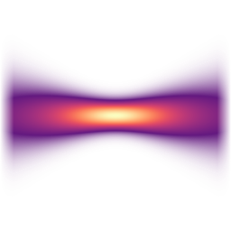
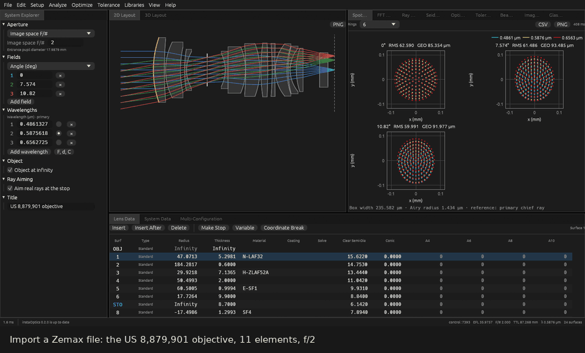

<p align="center">
  
</p>

<h1 align="center">instaOptics</h1>

<p align="center">
  <strong>免费开源的光学仿真软件，纯 Rust 编写。</strong><br />
  序列光学系统的设计与分析：修改镜头，所有分析结果实时联动更新。支持桌面端交互、命令行脚本控制，以及通过内置 MCP 服务由 AI Agent 直接驱动。
</p>

<div align="center">

[][releases]
[][releases]
[][releases]
[](https://instaoptics.oneptica.com)

</div>

<p align="center">
  <a href="https://github.com/Oneptica/instaOptics/actions/workflows/ci.yml"></a>
  <a href="https://github.com/Oneptica/instaOptics/releases/latest"></a>
  <a href="https://github.com/Oneptica/instaOptics/releases"></a>
  <a href="LICENSE"></a>
</p>

<p align="center">
  <a href="README.md">English</a> ·
  <a href="#下载">下载</a> ·
  <a href="#功能">功能</a> ·
  <a href="#计算精度">计算精度</a> ·
  <a href="#从源码构建">构建</a> ·
  <a href="#ai-agentmcp">MCP</a> ·
  <a href="#命令行与脚本">CLI</a> ·
  <a href="#文档">文档</a>
</p>



*从 Zemax 文件导入 US 8,879,901 物镜（11 片，F/2）：移动像面，点列图随之变化；优化后截距；随后查看 MTF 与三维布局。由[演示脚本](examples/demo/record.py)录制，该脚本调用的命令与桌面端菜单完全一致。*

## 下载

| 平台 | 安装包 | 说明 |
|---|---|---|
| **Windows** | `.msi` 安装包 | 下次启动时自动更新 |
| **macOS** | `.dmg` 磁盘映像 | 通用版本（支持 Apple Silicon 与 Intel） |
| **Linux** | `AppImage`、`.deb`、`.tar.gz` | AppImage 下次启动时自动更新 |
| **网页版** | [instaoptics.oneptica.com](https://instaoptics.oneptica.com) | 无需安装，直接在浏览器中使用 |

所有安装包均可在[发布页][releases]获取。桌面端启动时会自动检查新版本（Windows 安装版与 Linux AppImage 会在下次启动时自动完成更新）。`0.1.8` 及以前为 Electron 版本，需手动下载一次 `0.2.0` 以升级至原生 Rust 版本。

## 功能

### 序列光线追迹与系统建模
- **面型：** 支持球面、二次曲面、偶次非球面、反射镜与坐标断点，支持真实光线瞄准
- **孔径与视场：** 孔径支持入瞳直径、F 数、物方数值孔径及按光阑浮动；视场支持角度、物高与像高
- **玻璃库：** 内置肖特（Schott）玻璃库、熔石英、氟化钙及 `nd/vd` 模型玻璃；支持加载 OpticStudio `.agf` 玻璃库（覆盖全部 13 种色散公式），并提供玻璃搜索窗口与阿贝图
- **多重结构与求解：** 支持多重结构数据、边缘光线高度求解及参数关联（Pickup）

### 像质分析与可视化
- **几何与衍射分析：** 点列图、光线像差曲线（Ray Fan）、FFT MTF、离焦 MTF、MTF 随视场、FFT PSF、波前图
- **像差与照度：** 场曲与畸变、色焦移、赛德尔像差、相对照度、足迹图
- **布局与导出：** 交互式二维和三维布局图；图像支持导出 PNG，数据支持导出 CSV

### 物理光学、镀膜与偏振
- **光束传播：** 支持高斯、超高斯与平顶光束在系统中的传播分析，可选轴上或沿任意视场主光线传播，提供光束侧视图、截面分布、光束半径及单模光纤耦合效率
- **镀膜与偏振：** 支持逐面配置薄膜镀膜（MgF₂、四分之一波长膜层、高反膜、金属），提供反射率/透射率曲线及偏振光线追迹（计算光瞳上的透过率、二向衰减与相位延迟）
- **成像仿真：** 支持使用内置测试图或任意图片进行成像仿真

### 优化与公差分析
- **阻尼最小二乘优化：** 配备评价函数编辑器，内置焦距、总长、畸变、主光线角等操作数，支持按视场与结构独立设置
- **公差分析：** 支持灵敏度分析与蒙特卡洛模拟

### 兼容性与界面
- **Zemax 兼容：** 支持 `.zmx` 文件的导入与导出
- **多语言界面：** English、简体中文、繁體中文、日本語、한국어、Deutsch、Français、Español、Русский（视图 → 语言）

## 计算精度

US 8,879,901 物镜在 `cargo test` 中与独立的开源光线追迹程序 [optiland](https://github.com/HarrisonKramer/optiland) 进行交叉验证：
- **近轴参数**（EFL、BFL、入瞳直径和光瞳位置）相对误差不超过 `1.2e-5`。
- **实际光线追迹**（3 个视场 × 3 个波长 × 6 个光瞳点，共 54 根光线）在像面上的交点与 optiland 相差不超过 `0.02 µm`。

参考验证脚本：[examples/validation/us8879901.py](examples/validation/us8879901.py)。

## 从源码构建

需要 **Rust 1.95+**（stable）。Linux 下构建无需额外系统依赖（文件对话框通过 XDG desktop portal 实现）。

```sh
cargo run --release -p instaoptics                   # 启动桌面程序
cargo run --release -p instaoptics-cli -- commands   # 查看全部命令及参数
cargo test --workspace                               # 运行全部测试
```

各平台打包脚本位于 [packaging/](packaging/)，代码分层与模块说明见 [docs/architecture.md](docs/architecture.md)。

## AI Agent（MCP）

`instaoptics-cli mcp` 通过 stdio 提供 [Model Context Protocol](https://modelcontextprotocol.io) 服务。既可以独立运行并操作内存中的镜头，也可以连接至运行中的桌面端，在界面里实时查看修改效果。

- **独立运行（无界面）：**
  ```sh
  claude mcp add instaoptics -- instaoptics-cli mcp
  ```
- **连接桌面端实时联动：**
  ```sh
  instaoptics --control 7391
  instaoptics-cli mcp --connect 127.0.0.1:7391
  ```

通用 MCP 客户端配置示例（如 Claude Desktop、Cursor）：

```json
{
  "mcpServers": {
    "instaoptics": {
      "command": "instaoptics-cli",
      "args": ["mcp", "--connect", "127.0.0.1:7391"]
    }
  }
}
```

完整工具列表（`inspect`、`execute`、`analyze`、`render`、`list_commands`、`screenshot`、`open_window`）及使用示例见 [docs/mcp.md](docs/mcp.md)。

## 命令行与脚本

桌面端菜单中的每一项操作都对应一条底层命令，`instaoptics-cli` 与桌面端共用同一套命令系统：

```sh
instaoptics-cli convert design.zmx design.iol
instaoptics-cli analyze lens.iol --request '{"kind":"mtf"}'
instaoptics-cli render lens.iol --view spot --out spot.png
instaoptics-cli run lens.iol \
  --cmd 'variable {"surface":2,"parameter":"radius"}' \
  --cmd 'optimize {"cycles":20}' \
  --save out.iol
```

镜头文件采用 `.iol`（JSON）格式。长度单位为 **mm**，波长单位为 **µm**，角度单位为**度**。命令和界面中的面号均从 1 开始编号。

## 文档

| 文档 | 内容 |
|---|---|
| [docs/architecture.md](docs/architecture.md) | Crate 分层架构（`core` → `io`/`render` → `engine` → `ui-egui`/`mcp`）、绘图管线、后台工作线程 |
| [docs/cli.md](docs/cli.md) | CLI 子命令、脚本文件格式、环境变量与退出码 |
| [docs/mcp.md](docs/mcp.md) | MCP 服务配置、工具说明与典型交互流程 |
| [docs/control-protocol.md](docs/control-protocol.md) | 用于驱动桌面端的 TCP 控制通道协议 |

## 许可证

基于 [MIT 许可证](LICENSE)开源。

[releases]: https://github.com/Oneptica/instaOptics/releases/latest
